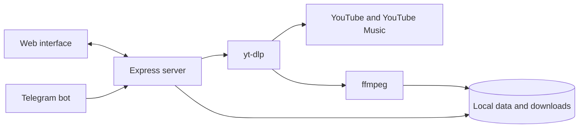

<p align="center">
  
</p>

<h1 align="center">YTgrab</h1>

<p align="center">A self-hosted home for the videos and music you want to keep close.</p>


YTgrab brings YouTube into a space you run yourself. Search and watch videos, follow channels and artists, build playlists, stream music, and keep downloads on your server. A private Telegram bot can find videos and send download links when you're away from the browser.

## What you can do

| Space | What you get |
| --- | --- |
| **Watch** | Search YouTube, follow channels, browse a personal feed, and pick up from watch history. |
| **Listen** | Search YouTube Music for songs, artists, and albums. Open artist pages, play audio, and see lyrics when available. |
| **Keep** | Make video and music playlists, save favorites, and download video or the best available audio. |
| **Reach it anywhere** | Use the web interface or the optional Telegram companion. |

The web interface uses a password. Your subscriptions, playlists, history, preferences, and downloaded files stay on your server.

## Get started

You need Node.js **20.19+**, a current `yt-dlp` installation, and `ffmpeg`. If your Node.js version is below 22, install Deno **2.3+** for yt-dlp's JavaScript challenges.

```bash
npm install
cp .env.example .env
```

Set `PORT` and `YTGRAB_PASSWORD` in `.env`, then build and start the web app:

```bash
npm run build
npm run start:web
```

Open `http://127.0.0.1:3000` unless you changed the port. To run the Telegram bot as well, set `YTGRAB_URL`, `TELEGRAM_BOT_TOKEN`, and `ALLOWED_USER_IDS` in `.env`, then use `npm start`. That command builds the frontend and starts both processes.

| Setting | Purpose |
| --- | --- |
| `PORT` | Web server port. |
| `YTGRAB_PASSWORD` | Password for the web app and bot's API session. |
| `YTGRAB_URL` | URL the Telegram bot uses to reach the web server. |
| `TELEGRAM_BOT_TOKEN` | Token for the optional Telegram bot. |
| `ALLOWED_USER_IDS` | Comma-separated Telegram user IDs allowed to use the bot. |
| `YT_DLP_COOKIES` | Path to a Netscape-format YouTube cookie file, recommended on hosted servers. |
| `YT_DLP_USER_AGENT` | Browser User-Agent from the session that exported those cookies, if needed. |
| `YT_DLP_PROXY` | Optional outbound proxy for yt-dlp. |
| `YT_DLP_PLAYER_CLIENT` | Optional yt-dlp YouTube player client override; use `mweb` with a working PO-token provider. |
| `YTGRAB_STREAM_CACHE_GB` | HLS cache cleanup target in GB; defaults to 8. |

See [.env.example](.env.example) for the template.

## A note on hosted servers

YouTube often challenges datacenter IP addresses. YTgrab uses yt-dlp's default clients for media, with optional cookies and a PO-token provider. If you have a working provider, set `YT_DLP_PLAYER_CLIENT=mweb` to use it. On a hosted server, configure cookies and a provider before relying on playback and downloads.

<details>
<summary>Set up the PO-token provider and YouTube cookies</summary>

Install the provider plugin into the same Python environment as yt-dlp:

```bash
python3 -m pip install -U bgutil-ytdlp-pot-provider
```

On Debian with an externally managed Python environment, add `--break-system-packages` if required. Run the provider on loopback:

```bash
docker run --name bgutil-provider --restart unless-stopped -d --init \
  -p 127.0.0.1:4416:4416 brainicism/bgutil-ytdlp-pot-provider
```

If the container already exists, run `docker start bgutil-provider`. Check that `yt-dlp -v VIDEO_URL` reports a `bgutil` PO-token provider.

Treat `cookies.txt` like a password. Use a separate YouTube account and keep the file out of git.

1. Open a private browser window and allow a trusted cookie-export extension there.
2. Sign in to YouTube, then open `https://www.youtube.com/robots.txt` in the same tab.
3. Export `youtube.com` cookies in Netscape format.
4. Close the private window so the session is not rotated.
5. Put the file in the YTgrab directory as `cookies.txt` and run `chmod 600 cookies.txt`.
6. Set `YT_DLP_COOKIES=cookies.txt` in `.env`. If needed, set `YT_DLP_USER_AGENT` to the User-Agent from the same browser session.

The file should begin with `# Netscape HTTP Cookie File`. Verify media access before starting YTgrab:

```bash
yt-dlp --cookies cookies.txt \
  --extractor-args "youtube:player_client=mweb" \
  -F "https://www.youtube.com/watch?v=VIDEO_ID"
```

That command should list formats. If YouTube later returns `LOGIN_REQUIRED`, refresh the cookie file using the same process.

</details>

## How it fits together



Heavy mode keeps a snapshot of the first two feed pages. After the first fetch, those videos can appear immediately on login while the server refreshes them. Playback uses HLS segments as they become ready, and old stream cache entries are cleaned up automatically.

Video playlists are stored in `data/video-playlists.json`; music favorites, followed artists, and playlists are stored in `data/music-library.json`. The lyrics view checks [LRCLIB](https://lrclib.net/docs) when opened and falls back to available YouTube captions. Some songs have neither.

## Run it your way

```bash
npm run dev        # Express API and Vite frontend for development
npm run start:web  # web server only; build first
npm run start:bot  # Telegram bot only
npm start          # build, then run web server and bot
```

For a long-running process, use your preferred service manager. If you already use PM2:

```bash
pm2 start npm --name ytgrab -- start
pm2 save
```

## License

[MIT](LICENSE)
